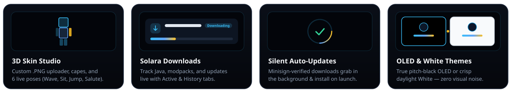
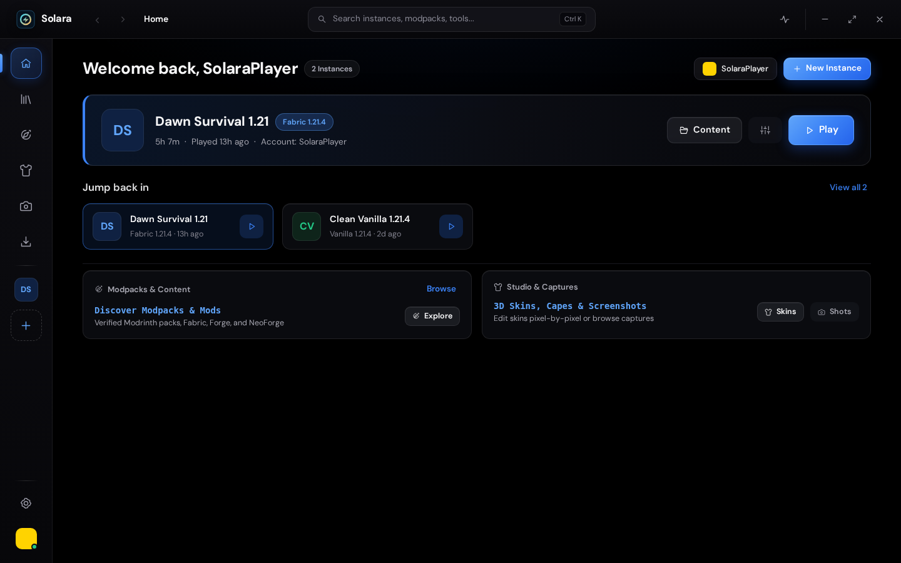
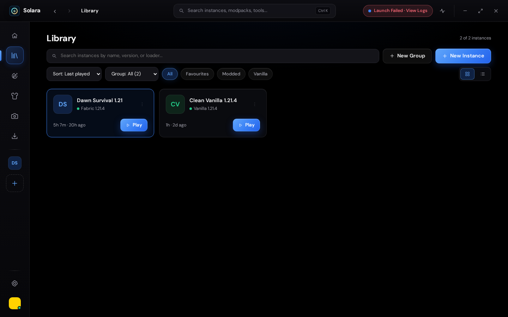

<p align="center">
  
</p>

<p align="center">
  <a href="https://github.com/Solara-Inc-Development/solara-launcher/actions/workflows/windows-check.yml">
    
  </a>
  <a href="https://github.com/Solara-Inc-Development/solara-launcher/releases/latest">
    
  </a>
  
  
  <a href="LICENSE">
    
  </a>
</p>

<p align="center">
  <a href="#why-we-built-solara"><strong>Why Solara</strong></a> &nbsp;·&nbsp;
  <a href="#whats-inside"><strong>What's inside</strong></a> &nbsp;·&nbsp;
  <a href="#download"><strong>Download</strong></a> &nbsp;·&nbsp;
  <a href="#run-it-yourself"><strong>Build from source</strong></a> &nbsp;·&nbsp;
  <a href="#privacy--accounts"><strong>Privacy</strong></a> &nbsp;·&nbsp;
  <a href="https://app.solara-inc.in"><strong>Website</strong></a>
</p>

<p align="center">
  
</p>

## Why we built Solara

Most Minecraft launchers either feel stuck in 2014 or pack the screen with ads, sidebars, and toggles nobody ever touches. We just wanted a launcher that opens fast, looks genuinely clean on an OLED monitor (or a bright desk setup), lets you browse modpacks and manage your skins without fighting the UI, and stays out of your way when you just want to play.

So we're building **Solara Launcher** — Windows-first, lightweight, zero ads, and updated straight from GitHub Releases with cryptographic verification.

<p align="center">
  
</p>

<p align="center">
  
</p>

## What's inside

<table>
  <tr>
    <td width="50%" valign="top">
      <h3>Clean Home &amp; Library</h3>
      <p>
        Open straight into a distraction-free welcome hero with your live 3D Minecraft character, quick news &amp; update cards, and a dedicated <strong>Library</strong> tab where every instance lives in its own isolated folder.
      </p>
    </td>
    <td width="50%" valign="top">
      <h3>Interactive 3D Skin Studio</h3>
      <p>
        Drag and drop your <code>.png</code> skins, switch between Classic (4px) and Slim (3px) models, equip capes, and test 6 live poses right on the stage (Wave, Sit, Jump, Stretch, Look, and Salute).
      </p>
    </td>
  </tr>
  <tr>
    <td width="50%" valign="top">
      <h3>ModPackInstaller &amp; Loaders</h3>
      <p>
        Vanilla, Fabric, Quilt, Forge, and NeoForge all work out of the box with automatic Java runtime installs, per-instance screenshots, and a clean inline sidebar when browsing modpacks.
      </p>
    </td>
    <td width="50%" valign="top">
      <h3>Solara Downloads &amp; Auto-Updates</h3>
      <p>
        Watch Java runtimes, modpacks, and files install live in our custom <strong>Solara Downloads</strong> tray (with separate Active &amp; History tabs). New launcher releases download quietly in the background and install cleanly on your next launch.
      </p>
    </td>
  </tr>
  <tr>
    <td width="50%" valign="top">
      <h3>Two Themes, Zero Bloat</h3>
      <p>
        Pick between true pitch-black <strong>OLED</strong> or clean daylight <strong>White</strong> in Settings → Theme. No confusing settings mazes, no ads, and no OS window-frame clutter.
      </p>
    </td>
    <td width="50%" valign="top">
      <h3>Real Accounts Only</h3>
      <p>
        Sign in directly with Microsoft using official OAuth + PKCE. Tokens stay in Windows Credential Manager on your own PC — never sent to Solara servers. No cracked accounts.
      </p>
    </td>
  </tr>
</table>

<details>
<summary><strong>Preview screenshots from local development</strong></summary>

<br />

<p align="center">
  
</p>

<p align="center">
  
</p>

<p align="center"><sub>Captured from browser dev fixtures with native IPC mocked — not proof of live sign-in or game launch.</sub></p>

</details>

> [!NOTE]
> **Being upfront about the engine:** Right now, Solara still uses a Modrinth/Theseus-derived local engine under the hood while we work toward our own independent core. We keep all required upstream notices and licences intact in [THIRD_PARTY_NOTICES.md](THIRD_PARTY_NOTICES.md).

<p align="center">
  
</p>

## Download

**Testing preview V-0.0.78 available.** Custom mini Solara Launcher window previews for OLED & White themes under the renamed Settings → Theme tab, removed Features & Behavior tabs with locked clean defaults, ModPackInstaller navigation fix with inline sidebar, redesigned Solara Downloads drawer, 3D Skin Studio with custom uploader & 6 live poses, redesigned Solara-Inc splash screen, and background Minisign-verified auto-updates.

The installer and app are always just **`solaralauncher.exe`** — no version junk in the filename. Install it once and let the built-in Minisign updater handle the rest whenever your games and downloads are idle.

- **GitHub Release:** [Solara Launcher V-0.0.78 (Latest)](https://github.com/Solara-Inc-Development/solara-launcher/releases/latest)
- **Installer (20.4 MB):** [GitHub Download](https://github.com/Solara-Inc-Development/solara-launcher/releases/download/V-0.0.78/solaralauncher.exe) · [Portal Mirror](https://app.solara-inc.in/builds/V-0.0.78/solaralauncher.exe)
- **Signature (Minisign):** [`solaralauncher.exe.sig`](https://github.com/Solara-Inc-Development/solara-launcher/releases/download/V-0.0.78/solaralauncher.exe.sig)
- **Exact Source Archive:** [`source.zip`](https://github.com/Solara-Inc-Development/solara-launcher/releases/download/V-0.0.78/source.zip)
- **SHA-256:** `568839218ccc8f6dcf0eb947889fbd2c771fad42ad4892e7426ced0a2b59f23b`

| Area | Status | Notes |
| :--- | :--- | :--- |
| **Executable** | `solaralauncher.exe` | Clean single filename for both installer & app |
| **Platform** | Windows 10 / 11 (x64) | Native CI compile & tests pass; real-device acceptance in progress |
| **Latest Preview** | `V-0.0.78` live | Privately signed with our persistent Minisign updater key |
| **Loaders** | Vanilla, Fabric, Quilt, Forge, NeoForge | Official manifests + automatic Java runtime setup |
| **Auto-Updates** | GitHub Releases CDN | Minisign-verified `latest.json` + silent background downloads |
| **Website** | [app.solara-inc.in](https://app.solara-inc.in) | Official launcher site & download portal |

> Heads up: this is still a **testing preview**. Automated Windows builds, checksums, and updater signatures are verified, while full real-PC acceptance testing (fresh install, Microsoft sign-in, gameplay, and live upgrade/relaunch) is still being wrapped up. You need an official Minecraft Java Edition account to play.
>
> Spot a bug or something that feels off? Open an issue or reach out — even tiny UI nitpicks help a ton.

<p align="center">
  
</p>

## Run it yourself

Frontend is **Vue 3 + TypeScript + Tailwind**, desktop shell & core are **Tauri 2 + Rust**.

### Quick browser preview

```sh
pnpm install --frozen-lockfile
npm run web:dev
```

| Target | Local URL | What it runs |
| :--- | :--- | :--- |
| **Launcher website** | `http://127.0.0.1:1420/` | Main landing page & release portal |
| **Desktop UI** | `http://127.0.0.1:1420/` via `pnpm --filter @modrinth/app-frontend dev --host 127.0.0.1` | Desktop frontend (run one dev server on port `1420` at a time) |

### Run checks & production builds

```sh
npm test
npm run check
npm run build:verify
pnpm --filter @modrinth/app-frontend build
```

<details>
<summary><strong>Native Rust tests &amp; extra docs</strong></summary>

<br />

Run the Rust core & desktop updater unit tests:

```sh
cargo test -p theseus --lib --locked
cargo test -p theseus_gui --bin solaralauncher --locked
```

And if you want the deeper guides:
- **[Build &amp; release guide](docs/BUILD-RELEASE.md)** — Windows packaging, signing, and release flow
- **[Authentication setup](docs/AUTH-SETUP.md)** — Microsoft OAuth client setup
- **[API reference](docs/API.md)** — Public launcher API endpoints & schemas
- **[Design notes](docs/DESIGN.md)** — UI, theming, and interaction choices

</details>

<p align="center">
  
</p>

## Privacy &amp; accounts

<table>
  <tr>
    <td width="50%" valign="top">
      <h3>Stays strictly on your PC</h3>
      <ul>
        <li>Your Minecraft worlds, saves, mods, screenshots, and logs</li>
        <li>Instance folders and Java memory/launch settings</li>
        <li>Microsoft login tokens (saved in Windows Credential Manager — never sent to Solara)</li>
      </ul>
    </td>
    <td width="50%" valign="top">
      <h3>Fetched from Solara (<code>api.solara-inc.in</code>)</h3>
      <ul>
        <li>Public release metadata and version changelogs</li>
        <li>Website status and download mirrors</li>
        <li>No tracking telemetry, no ads, and no Solara account required to play</li>
      </ul>
    </td>
  </tr>
</table>

The private backend lives outside this repository; this repo holds the public desktop app and website source.

<br />

<p align="center">
  <a href="https://app.solara-inc.in">Website</a> &nbsp;·&nbsp;
  <a href="https://www.solara-inc.in/contact">Support</a> &nbsp;·&nbsp;
  <a href="CHANGELOG.md">Changelog</a> &nbsp;·&nbsp;
  <a href="LICENSE">GPL-3.0 License</a> &nbsp;·&nbsp;
  <a href="THIRD_PARTY_NOTICES.md">Third-Party Notices</a>
</p>

<p align="center">
  
</p>

<p align="center">
  <sub>Public source licensed under GPL-3.0-only. All third-party notices are bundled in the app. Not affiliated with Mojang AB or Microsoft.</sub>
</p>
