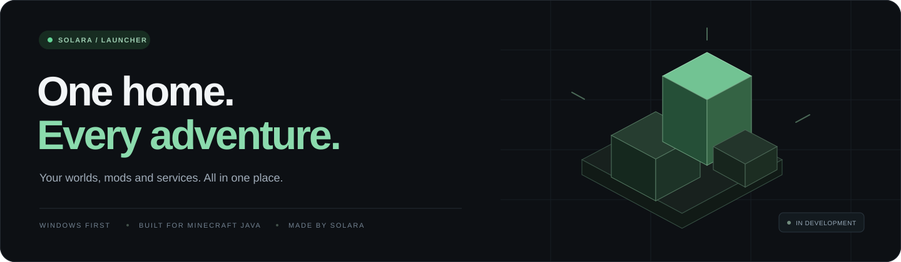
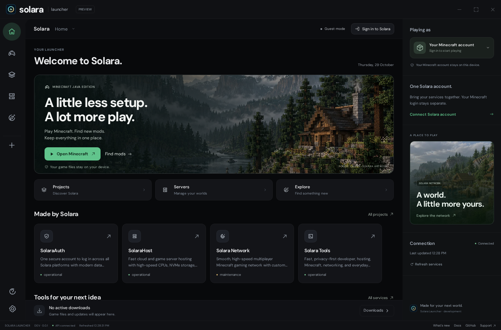
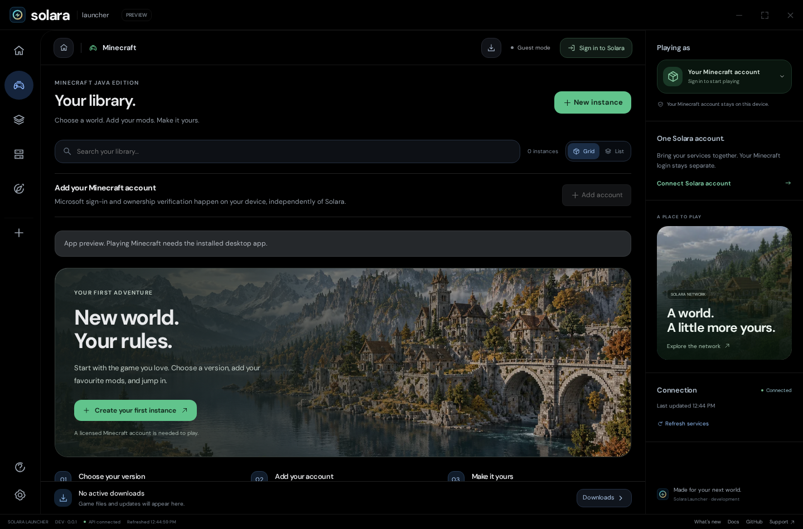

<p align="center">
  
</p>

<p align="center">
  <strong>Built for Minecraft Java and everyday Solara tools.</strong><br />
  Pure black layout. Simple controls. Nothing noisy in your way.
</p>

<p align="center">
  <a href="https://github.com/Solara-Inc-Development/solara-launcher/actions/workflows/windows-check.yml"></a>
  
  
  
  <a href="LICENSE"></a>
</p>

<p align="center">
  <a href="#meet-your-launcher">Overview</a> &nbsp; · &nbsp;
  <a href="#a-place-for-your-next-adventure">Library</a> &nbsp; · &nbsp;
  <a href="#download">Download status</a> &nbsp; · &nbsp;
  <a href="#build-it-yourself">Build from source</a> &nbsp; · &nbsp;
  <a href="#built-around-your-device">Privacy</a> &nbsp; · &nbsp;
  <a href="https://www.solara-inc.in/contact">Get help</a>
</p>

---

## Meet your launcher

A black desktop, a small sidebar and your account right where you need it. Open your worlds, check your services, or just look around. We wanted the everyday stuff to feel easy.

<p align="center">
  
</p>

<p align="center"><sub>Actual development interface. Listings come from a local development API using existing Solara sources. This is not a release or a live sign-in demo.</sub></p>

<table>
<tr>
<td width="33%" valign="top">

### Your worlds

Give each Minecraft setup its own space. Search instances by name or version, and switch between grid and list views whenever you want.

</td>
<td width="33%" valign="top">

### Your services

Explore Solara projects and supported server tools in the same window. Public browsing works as a guest; protected actions use your Solara account.

</td>
<td width="33%" valign="top">

### Your pace

Smooth little animations, clear loading screens and colours that don't shout at you. Less motion if you prefer it. And yep, no glow effects.

</td>
</tr>
</table>

---

## A place for your next adventure

<p align="center">
  
</p>

<table>
<tr>
<td width="50%" valign="top">

**Isolated instances**<br />
Keep setups separate inside their own folders so testing a new version never messes with your main world saves.

</td>
<td width="50%" valign="top">

**Real download tracking**<br />
Follow actual file progress in the bottom bar, with clear error states and one-click retry if an install gets interrupted.

</td>
</tr>
<tr>
<td width="50%" valign="top">

**Two separate accounts**<br />
Solara connects your services and hosting. Minecraft sign-in happens directly with Microsoft and stays on your PC.

</td>
<td width="50%" valign="top">

**Local server starter**<br />
Run a local Java server on your own machine with EULA checks, memory/port settings and a live console view.

</td>
</tr>
</table>

> [!NOTE]
> **Still being built:** the local Minecraft engine is independently written. Current source supports Vanilla, Fabric, Quilt, Forge, and NeoForge setups, automatic Java downloads, per-instance file/mod/backup management (including local `.jar` mod imports and world/config snapshots) and verified community content/modpack installs. Real sign-in, game launch and automatic Windows updates still need acceptance testing. Screenshots show working interface code, not proof that every integration is ready.

---

## Download

**Testing preview V-0.0.13 available.** Fresh genuine Windows release featuring dynamic RAM Performance Ring Gauge with optimal workload feedback, one-click Modpack Exporter Archive generation, streamlined instance creation, and instant Backups folder system shortcuts.

The download and installed app are named **`solaralauncher.exe`**. Install once; cryptographically signed updates download and apply automatically when games, local servers and downloads are idle.

Download the testing build directly:
- **GitHub Release**: [Solara Launcher V-0.0.13 (Latest)](https://github.com/Solara-Inc-Development/solara-launcher/releases/latest)
- **Installer (6.5 MB)**: [GitHub Download](https://github.com/Solara-Inc-Development/solara-launcher/releases/download/V-0.0.13/solaralauncher.exe) · [Portal Mirror](https://app.solara-inc.in/builds/V-0.0.13/solaralauncher.exe)
- **Signature (Minisign)**: [`solaralauncher.exe.sig`](https://github.com/Solara-Inc-Development/solara-launcher/releases/download/V-0.0.13/solaralauncher.exe.sig)
- **Source Code**: [`source.zip`](https://github.com/Solara-Inc-Development/solara-launcher/releases/download/V-0.0.13/source.zip)
- **SHA-256**: `579e24573222afd6063d8d66e59baaa182d3e0bb2d08fb971fbeaa4a9d235cc8`

| Area | Current status | Details |
| :--- | :--- | :--- |
| **Executable** | `solaralauncher.exe` | Single installer & app name — no version clutter in the filename |
| **First platform** | Windows 10 / 11 (x64) | Native compile & unit checks pass; final device testing pending |
| **Testing installer** | V-0.0.13 live | Clean native Win32 calls, signed with persistent Minisign key |
| **Minecraft core** | Vanilla, Fabric, Quilt, Forge, NeoForge | Official manifest, Maven & package hashes verified; full loader support |
| **App updates** | Live auto-update | Live on `https://api.solara-inc.in/v1/launcher/update/windows/x86_64` |
| **Official website** | [app.solara-inc.in](https://app.solara-inc.in) | Live responsive website with Let's Encrypt certificates |

There's still a few things to test before we call this a stable release. The Windows build and installer files passed our checks; real installation, Microsoft login, game play and automatic upgrades still need testing. Sign-in needs an approved Solara Microsoft app ID and hosted services need their separate setup. You need a valid Minecraft Java licence to play.

Found something that feels off? Tell us what happened, even the small stuff helps.

---

## Build it yourself

**Vue 3** for the interface. **Tauri 2 + Rust** for desktop code. Shared components power both the desktop launcher and the website.

### 1. Preview the interface in your browser

```sh
npm ci
npm run dev
```

| Target | Local address | Notes |
| :--- | :--- | :--- |
| **Launcher website** | `http://127.0.0.1:1420/` | Marketing, release archive & status views |
| **Desktop interface** | `http://127.0.0.1:1420/desktop.html` | UI preview only — does not simulate Minecraft accounts or native processes |

### 2. Run checks and build the frontend

```sh
npm test
npm run check
npm run build
```

For full Rust/Tauri desktop compilation, signing and packaging instructions, read the **[Build & release guide](docs/BUILD-RELEASE.md)**. Authentication registration and setup steps are in the **[Authentication setup guide](docs/AUTH-SETUP.md)**, public API routes and schemas are documented in the **[API guide](docs/API.md)**, and visual/interaction notes live in **[Design notes](docs/DESIGN.md)**.

<details>
<summary><strong>More development &amp; native checks</strong></summary>

<br />

With the UI development server running and Playwright Chromium installed:

```sh
npm run test:ui
npm run test:motion
npm run test:workflows
npm run test:csp
```

Browser workflow tests use clearly labelled provider/native fixtures. They do not install Minecraft, provision DNS or prove live authentication.

To run the Rust unit suites for the independent game core and local server manager:

```sh
cargo test -p solara-launcher -p solara-local-server --lib --locked
```

</details>

---

## Built around your device

<table>
<tr>
<td width="50%" valign="top">

### Stays on your PC
- Minecraft worlds, saves, screenshots and logs
- Local instance folders and Java launch settings
- Microsoft refresh credentials (stored in Windows Credential Manager — never sent to Solara)

</td>
<td width="50%" valign="top">

### Uses Solara (`api.solara-inc.in`)
- Public project and service directory (works in guest mode)
- Signed launcher release and update metadata
- Optional Solara account for your hosted servers, tools and subdomain assignments

</td>
</tr>
</table>

The Solara service backend is private and **is not included in this repository**. This repository contains the public desktop and website source.

---

<p align="center">
  <br /><br />
  <strong>Make it your world.</strong><br />
  <sub>Made by Solara · Windows first · Minecraft Java</sub><br /><br />
  <a href="https://www.solara-inc.in">Solara</a> &nbsp; · &nbsp;
  <a href="https://www.solara-inc.in/contact">Support</a> &nbsp; · &nbsp;
  <a href="CHANGELOG.md">Changelog</a> &nbsp; · &nbsp;
  <a href="LICENSE">Licence</a> &nbsp; · &nbsp;
  <a href="THIRD_PARTY_NOTICES.md">Third-party notices</a>
</p>

<p align="center">
  <sub>Public source: GPL-3.0-only. Dependency notices and their licences are included. Solara is not affiliated with Mojang or Microsoft.</sub>
</p>
